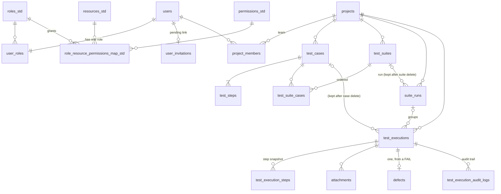

# Database schema

PostgreSQL 17. All tables live in the schema **`tcms`** (owned by `tcms_app_user`), including the migration
history table `pgmigrations`. The app sets `search_path=tcms`, so its SQL is unqualified. The schema is built
by the SQL files in [`../migrations/`](../migrations/), applied in order with `npm run migrate:up`.

This document describes the schema as of 2026-11-17 (23 migrations). The migrations are the source of truth:
when they change, update this document.

## Conventions

- **Primary keys** are `integer GENERATED ALWAYS AS IDENTITY`. The client can never choose an id.
  - **Exception: `users.id`** is a `uuid` (`gen_random_uuid()`), because user ids appear in URLs and must
    not be guessable.
  - The API returns integer ids as JSON numbers and user ids as strings.
- **Dates** are `timestamptz`, returned as ISO 8601 UTC.
- **Enum-like columns** are `text` with a named `CHECK`, holding `UPPER_SNAKE_CASE` values (`ON_HOLD`,
  `TEST_LEAD`). The same values are used in SQL, TypeScript and JSON, with no mapping layer. A `CHECK` is
  easier to change than a Postgres enum type.
- **Constraint and index names:**
  - `pk_<table>`, `fk_<table>_<referenced>[_<role>]`, `uq_<table>_<columns>`, `ck_<table>_<rule>`,
    `idx_<table>_<columns>`.
  - The API maps some of them to errors. For example, `uq_users_email` becomes `409` on `email`.
- **`created_by`** (who created the row) is on most tables. It references `users` with
  `ON DELETE SET NULL`.
- **Text limits** are enforced twice: by `varchar(n)` in the database, and with the same numbers by the
  zod schemas in the API. Required text also has a `ck_…_not_blank` check (`btrim(x) <> ''`).
- **Tables ending in `_std`** hold standard data (roles and permissions):
  - only migrations write them; the API has no write endpoint;
  - rows are deactivated (`is_active = false`), never deleted.

## Overview

### Groups

| Group | Tables |
| --- | --- |
| Users and access | `users`, `user_invitations`, `user_roles`, `roles_std`, `resources_std`, `permissions_std`, `role_resource_permissions_map_std` |
| Projects | `projects`, `project_members` |
| Test design | `test_cases`, `test_steps`, `test_suites`, `test_suite_cases` |
| Execution | `suite_runs`, `test_executions`, `test_execution_steps`, `defects`, `attachments`, `test_execution_audit_logs` |

## Design decisions that span tables

### No cross-project links, enforced by the database

Project-scoped tables have `UNIQUE (id, project_id)`, and the tables pointing at them use a **composite
foreign key** `(x_id, project_id) → x(id, project_id)`. A suite can only hold test cases of its own
project, and an execution can only point at a test case and suite run of its own project. This holds even
if the API had a bug.

### Execution history outlives what it executed

- A test execution stores a **snapshot**: the test case title when it is created, the steps when its result
  is recorded. Test cases can be edited or deleted without rewriting history.
- When a test case is deleted, its executions keep their snapshot and their `test_case_id` becomes `NULL`
  (`ON DELETE SET NULL (test_case_id)`, Postgres 15+). Pending executions are deleted first:
  `ck_test_executions_pending_has_test_case`.
- When a suite is deleted, the same happens to its runs: `suite_runs.test_suite_id` becomes `NULL`, and the
  name stays in `suite_name`.

### Projects with content can't be deleted

Test cases, suites, executions and suite runs reference `projects` with `ON DELETE RESTRICT`. The API turns
the violation into `409 CONFLICT` (archive the project instead). An empty project deletes cleanly, and its
team goes with it (`CASCADE`).

### Denormalized last result

`test_cases.last_result` and `last_executed_at` are copied from the latest recorded execution, in the same
transaction that records it. The test case list can then filter and sort by them without a per-row
subquery (no N+1).

### Lists sorted by name use `lower(name)`

The case-insensitive order is served by `uq_test_suites_project_id_lower_name` for suites. Projects, users
and test cases (by title) sort without an index: projects and users are small lists, and test cases are
sorted within one project, a few thousand rows at most. An index on `(project_id, lower(title))` is the fix if
that ever shows up in `EXPLAIN ANALYZE`.

---

## Users and access

### `users`

| Column | Type | Null | Notes |
| --- | --- | --- | --- |
| `id` | uuid | no | `gen_random_uuid()` |
| `first_name` | varchar(100) | no | not blank |
| `last_name` | varchar(100) | yes | optional; `NULL` when absent, never blank |
| `email` | varchar(254) | no | unique (`uq_users_email`); always lowercase (`ck_users_email_lowercase`) |
| `password_hash` | text | yes | bcrypt (cost 12); `NULL` until the invitation is accepted |
| `status` | text | no | `INVITED` (default) · `ACTIVE` · `INACTIVE` |
| `created_at`, `updated_at` | timestamptz | no | |

- `ck_users_active_has_password`: an `ACTIVE` user always has a password.
- Index `idx_users_created_at_id` serves `sort=createdAt`.
- Users are never deleted, only deactivated, so history keeps its authors.

### `user_invitations`

A pending set-password link. Each user has at most one: re-sending replaces it; accepting or deactivating
deletes it.

| Column | Type | Null | Notes |
| --- | --- | --- | --- |
| `id` | integer | no | identity |
| `user_id` | uuid | no | unique; `CASCADE` |
| `token_hash` | char(64) | no | unique; SHA-256 of the emailed token. The token itself is never stored |
| `expires_at` | timestamptz | no | 72 h after creation; must be after `created_at` |
| `created_by` | uuid | yes | the admin who sent it |
| `created_at` | timestamptz | no | |

### `roles_std`, `resources_std`, `permissions_std`

Roles (`ADMIN`, `TEST_LEAD`, `TESTER`, `READ_ONLY`), the resources they act on, and the permissions
(`CREATE`, `READ`, `UPDATE`, `DELETE`).

- Each table has `<x>_code` (unique, `UPPER_SNAKE_CASE`), `<x>_name`, `description`, `is_active`,
  `created_at` and `updated_at`.
- `roles_std` also has `is_system`.
- The resources are:
  - `USER`, `PROJECT`, `ALL_PROJECTS`, `TEST_CASE`, `TEST_SUITE`, `TEST_EXECUTION`, `TEST_ASSIGNMENT`,
    `DEFECT`, `ANALYTICS`, `METRICS` (admin: cache metrics);
  - `ALL_PROJECTS` = act on every project, not only those you are a member of.
- At startup, the server checks that every code used in the code exists here, and refuses to start if one
  is missing.

### `role_resource_permissions_map_std`

One row per grant: `role_id`, `resource_id`, `permission_id` (unique together), `created_at`.

- Only active roles, resources and permissions grant anything.
- Grants are read on every request, so a change applies immediately.
- The grants per role are listed in the [user guide](user-guide.md#what-each-role-can-do).

### `user_roles`

Each user has exactly one role.

| Column | Type | Null | Notes |
| --- | --- | --- | --- |
| `id` | integer | no | identity |
| `user_id` | uuid | no | unique (`uq_user_roles_user_id`); `CASCADE` |
| `role_id` | integer | no | → `roles_std` |
| `created_by` | uuid | yes | who assigned the current role |
| `created_at` | timestamptz | no | when the current role was assigned |

## Projects

### `projects`

| Column | Type | Null | Notes |
| --- | --- | --- | --- |
| `id` | integer | no | identity |
| `name` | varchar(100) | no | not blank |
| `description` | varchar(1000) | no | default `''` |
| `version` | varchar(20) | no | default `''` |
| `status` | text | no | `ACTIVE` (default) · `ON_HOLD` · `COMPLETED` · `ARCHIVED` |
| `created_by` | uuid | yes | |
| `created_at`, `updated_at` | timestamptz | no | |

Index `idx_projects_created_at_id` serves `sort=createdAt`.

### `project_members`

The project's team. Admins (`ALL_PROJECTS`) see every project; every other role works only in projects they
are a member of.

| Column | Type | Null | Notes |
| --- | --- | --- | --- |
| `id` | integer | no | identity |
| `project_id` | integer | no | `CASCADE` |
| `user_id` | uuid | no | `CASCADE`; unique per project (`uq_project_members_project_id_user_id`, which also serves the membership check) |
| `created_by` | uuid | yes | who added the member |
| `created_at` | timestamptz | no | |

Index on `user_id`: "which projects is this user in?"

## Test design

### `test_cases`

| Column | Type | Null | Notes |
| --- | --- | --- | --- |
| `id` | integer | no | identity; `UNIQUE (id, project_id)` for composite FKs |
| `project_id` | integer | no | `RESTRICT` |
| `title` | varchar(255) | no | not blank |
| `description`, `pre_conditions`, `post_conditions` | varchar(5000) | no | default `''` |
| `priority` | text | no | `LOW` · `MEDIUM` · `HIGH` · `CRITICAL` |
| `type` | text | no | `FUNCTIONAL` · `INTEGRATION` · `REGRESSION` · `SMOKE` · `UI` · `API` |
| `tags` | text[] | no | default `{}`; at most 20, no `NULL` elements; stored lowercase |
| `last_result` | text | yes | `PASS` · `FAIL` · `BLOCKED` · `SKIPPED`; `NULL` = never executed |
| `last_executed_at` | timestamptz | yes | `NULL` exactly when `last_result` is (`ck_test_cases_last_result_has_time`) |
| `created_by` | uuid | yes | |
| `created_at`, `updated_at` | timestamptz | no | |

Indexes:

- `(project_id, created_at DESC, id DESC)`: `sort=createdAt`.
- `(project_id, priority)`, `(project_id, type)`, `(project_id, last_result)`: the list filters.
- GIN on `tags`: the tag filter (`tags && $1`).

Tags are a column, not a table: they have no attributes of their own yet.

### `test_steps`

| Column | Type | Null | Notes |
| --- | --- | --- | --- |
| `id` | integer | no | identity |
| `test_case_id` | integer | no | `CASCADE` |
| `step_order` | integer | no | > 0; unique per test case |
| `action`, `expected_result` | varchar(2000) | no | not blank |
| `created_at`, `updated_at` | timestamptz | no | |

The API replaces a test case's steps as a whole, numbering them 1..n.

### `test_suites`

| Column | Type | Null | Notes |
| --- | --- | --- | --- |
| `id` | integer | no | identity; `UNIQUE (id, project_id)` |
| `project_id` | integer | no | `RESTRICT` |
| `name` | varchar(150) | no | not blank; unique per project ignoring case (unique index on `(project_id, lower(name))`) |
| `description` | varchar(1000) | no | default `''` |
| `created_by` | uuid | yes | |
| `created_at`, `updated_at` | timestamptz | no | |

### `test_suite_cases`

Which test cases a suite holds, in which order.

| Column | Type | Null | Notes |
| --- | --- | --- | --- |
| `id` | integer | no | identity |
| `project_id` | integer | no | part of both composite FKs: suite and case must be in this project |
| `test_suite_id` | integer | no | `CASCADE`; a case appears in a suite once (`UNIQUE (test_suite_id, test_case_id)`) |
| `test_case_id` | integer | no | `CASCADE` (deleting a test case removes it from its suites) |
| `sequence_order` | integer | no | > 0; `UNIQUE (test_suite_id, sequence_order) DEFERRABLE` |
| `created_by` | uuid | yes | |
| `created_at` | timestamptz | no | |

The order constraint is deferrable, so it is checked at the end of the statement. A reorder can then
renumber the whole suite in one `UPDATE` (swaps included) without hitting a duplicate halfway through.

## Execution

### `suite_runs`

One run of a whole suite: it groups one execution per test case.

| Column | Type | Null | Notes |
| --- | --- | --- | --- |
| `id` | integer | no | identity; `UNIQUE (id, project_id)` |
| `project_id` | integer | no | `RESTRICT` |
| `test_suite_id` | integer | yes | composite FK to the suite; `SET NULL` when the suite is deleted |
| `suite_name` | varchar(150) | no | the suite's name at run time |
| `created_by` | uuid | yes | |
| `created_at` | timestamptz | no | |

Index `(test_suite_id, created_at DESC)` serves "a suite's runs, newest first".

### `test_executions`

One execution of one test case: pending (assigned, or part of a suite run) until a result is recorded, then
immutable.

| Column | Type | Null | Notes |
| --- | --- | --- | --- |
| `id` | integer | no | identity; `UNIQUE (id, project_id)` |
| `project_id` | integer | no | `RESTRICT` |
| `test_case_id` | integer | yes | composite FK; `SET NULL (test_case_id)` when the case is deleted |
| `suite_run_id` | integer | yes | composite FK; `NULL` for assigned or ad hoc executions |
| `test_case_title` | varchar(255) | no | snapshot at creation |
| `assignee_id` | uuid | yes | who should run it |
| `status` | text | no | `PENDING` (default) · `PASS` · `FAIL` · `BLOCKED` · `SKIPPED` |
| `comment` | varchar(5000) | no | default `''` |
| `executed_by` | uuid | yes | who recorded the result |
| `executed_at` | timestamptz | yes | `NULL` exactly while `PENDING` (`ck_test_executions_executed_at`) |
| `created_by` | uuid | yes | |
| `created_at`, `updated_at` | timestamptz | no | |

Indexes:

- `(project_id, status)`: queue and progress.
- `(assignee_id, status)`: "assigned to me".
- `(project_id, executed_at)`: trends over time.
- `(test_case_id, created_at DESC)`: a test case's history.
- `suite_run_id`, plus every user FK.

### `test_execution_steps`

The steps as they were when the result was recorded, with an optional result per step.

| Column | Type | Null | Notes |
| --- | --- | --- | --- |
| `id` | integer | no | identity |
| `test_execution_id` | integer | no | `CASCADE` |
| `step_order` | integer | no | > 0; unique per execution |
| `action`, `expected_result` | varchar(2000) | no | copied from the test case |
| `status` | text | yes | `PASS` · `FAIL` · `BLOCKED` · `SKIPPED`; `NULL` = not recorded per step |
| `comment` | varchar(2000) | no | default `''` |

### `defects`

At most one per execution, created from a failed execution.

| Column | Type | Null | Notes |
| --- | --- | --- | --- |
| `id` | integer | no | identity |
| `project_id` | integer | no | part of the composite FK to the execution |
| `test_execution_id` | integer | no | unique (`uq_defects_test_execution_id`, which makes "one per execution" atomic); `RESTRICT` |
| `title` | varchar(255) | no | not blank |
| `description` | varchar(5000) | no | default `''` |
| `severity` | text | no | `LOW` · `MEDIUM` · `HIGH` · `CRITICAL` |
| `created_by` | uuid | yes | |
| `created_at`, `updated_at` | timestamptz | no | |

Index `(project_id, created_at)` serves defect metrics.

### `attachments`

Files on a recorded execution. The file itself is on disk (`UPLOAD_DIR`); this row holds its metadata.

| Column | Type | Null | Notes |
| --- | --- | --- | --- |
| `id` | integer | no | identity |
| `test_execution_id` | integer | no | `RESTRICT` |
| `original_name` | varchar(255) | no | display only; path and control characters stripped |
| `stored_name` | varchar(100) | no | unique; a random UUID, the file's name on disk |
| `mime_type` | varchar(100) | no | detected from the content, never the client's claim |
| `size_bytes` | integer | no | 1 to 10,485,760 (10 MB) |
| `uploaded_by` | uuid | yes | |
| `created_at` | timestamptz | no | |

### `test_execution_audit_logs`

The execution's audit trail. Rows are only ever appended, in the same transaction as the change they record.

| Column | Type | Null | Notes |
| --- | --- | --- | --- |
| `id` | integer | no | identity |
| `test_execution_id` | integer | no | `CASCADE` |
| `action` | text | no | `CREATED` · `RESULT_RECORDED` · `ATTACHMENT_ADDED` · `DEFECT_CREATED` |
| `actor_id` | uuid | yes | who did it |
| `details` | jsonb | no | default `{}`; e.g. `{ "status": "FAIL" }`, `{ "defectId": 7 }` |
| `created_at` | timestamptz | no | |

Index `(test_execution_id, created_at)` serves reading the trail in order.
